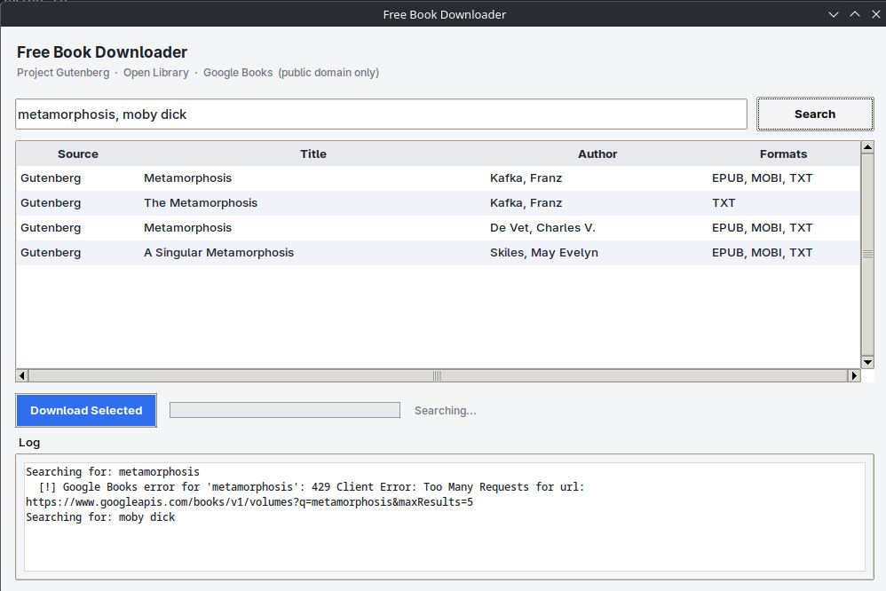

# Free Book Downloader

[](https://github.com/tahaenasraoui-debug/Open-source-book-downloader/actions/workflows/ci.yml)
[](LICENSE)

A desktop GUI for finding and downloading books that are genuinely free
and public domain, pulled from three sources:

- **Project Gutenberg** — full catalogue of public-domain texts.
- **Open Library / Internet Archive** — only items that are fully open
  access. Borrow-only (DRM-restricted) items are detected and skipped
  automatically; this tool never attempts to bypass lending restrictions.
- **Google Books** — only items Google's own API flags as public domain
  *and* provides a direct download link for. Most Google Books results
  are preview-only and won't appear here — that's expected.

Shadow libraries (Anna's Archive, Z-Library, LibGen, etc.) are not
supported and never will be, since they distribute copyrighted material
without a licence.

## Download

Grab the latest Windows executable from the
[Releases page](https://github.com/tahaenasraoui-debug/Open-source-book-downloader/releases/latest) — no Python required.

## Screenshot



## Running from source

Requires Python 3.9+.

```bash
pip install -r requirements.txt
python3 book_downloader_gui.py
```

On some Linux distributions, `tkinter` isn't installed by default:

```bash
# Debian/Ubuntu
sudo apt install python3-tk

# Fedora
sudo dnf install python3-tkinter

# Arch/Manjaro
sudo pacman -S tk
```

## Usage

1. Toggle which sources to query (**Gutenberg**, **Open Library**, **Google Books**) in the top-right bar.
2. Type one or more book titles into the search box (comma-separated) and click **Search** (or press `Enter`).
3. Click any column header to sort results by **Source**, **Title**, **Author**, **Year**, **Lang**, or **Formats**.
4. Choose your preferred format (`Auto`, `EPUB`, `PDF`, `TXT`, or `MOBI`) and destination folder (defaults to `~/Downloads/FreeBookDownloader`).
5. Select rows (`Ctrl+A` selects all; right-click or double-click opens the book's web page) and click **Download Selected** (or **Cancel** anytime). Click **Open Folder** to view saved files.

## Building the .exe yourself

```bash
pip install pyinstaller
pyinstaller --onefile --windowed --name BookDownloader book_downloader_gui.py
```

The executable will be in `dist/BookDownloader.exe`.

## Contributing

Contributions, bug reports, and feature suggestions are welcome. For larger changes or new features, please open an issue first to discuss the approach before writing code.

1. Fork the repository and create a branch from `main` (e.g., `git checkout -b fix/short-description` or `feat/short-description`).
2. Keep pull requests focused on a single change and follow the existing code style.
3. Run the local checks before opening a PR:

   ```bash
   ruff check .
   pytest
   ```

4. Open a Pull Request describing what changed and why (include a screenshot for UI changes, and link any related issue).

Only add or integrate legal public-domain and open-access sources (no shadow libraries or DRM bypass).

When reporting bugs, please include steps to reproduce, expected vs. actual behavior, and your environment details (OS and Python version).

## License

MIT — see [LICENSE](LICENSE).
